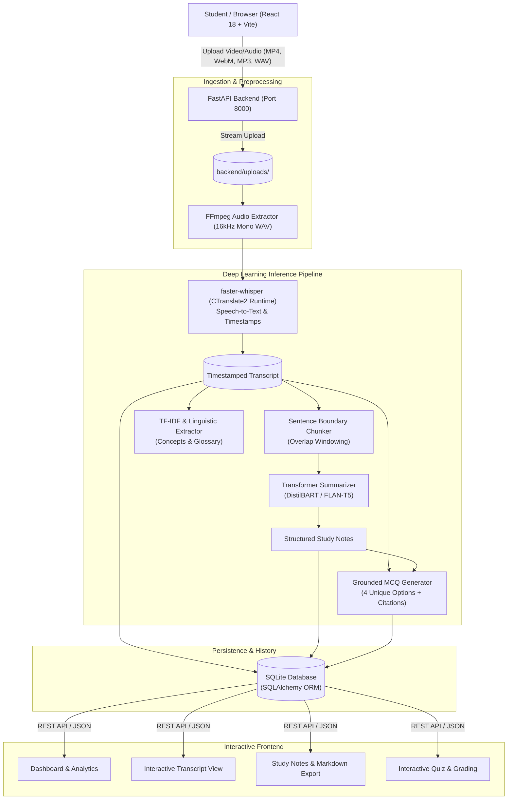

# AI-Powered Lecture Video Summarizer and Question Generator

[](https://www.python.org/)
[](https://fastapi.tiangolo.com/)
[](https://react.dev/)
[](https://vitejs.dev/)
[](https://pytorch.org/)
[](https://opensource.org/licenses/MIT)

> **Final-Year B.Tech Computer Science & Engineering (CSE) Capstone Project**  
> An end-to-end educational intelligence system converting lengthy lecture videos and audio recordings into timestamped transcripts, concise executive summaries, hierarchical study guides, extracted key concepts, and grounded self-assessment quizzes using real deep learning and Transformer models.

---

## Table of Contents
1. [Project Overview](#1-project-overview)
2. [System Architecture](#2-system-architecture)
3. [Folder Structure](#3-folder-structure)
4. [Key Features](#4-key-features)
5. [Technology Stack](#5-technology-stack)
6. [Academic & Syllabus Alignment](#6-academic--syllabus-alignment)
7. [Research & Empirical Evaluation](#7-research--empirical-evaluation)
8. [Benchmark Datasets](#8-benchmark-datasets)
9. [Prerequisites & Local Installation](#9-prerequisites--local-installation)
10. [Execution Instructions (Windows PowerShell)](#10-execution-instructions-windows-powershell)
11. [REST API Documentation](#11-rest-api-documentation)
12. [Automated Testing](#12-automated-testing)
13. [Deployment Guide](#13-deployment-guide)
14. [Troubleshooting](#14-troubleshooting)

---

## 1. Project Objective

Students frequently face cognitive fatigue when reviewing multi-hour university lecture recordings. Traditional video playback does not facilitate rapid non-linear concept lookup, structured revision, or immediate self-testing.

**LectureAI** solves this through a modular, asynchronous deep learning pipeline:
- **Speech Recognition:** Extracts 16kHz mono audio from video files and transcribes lecture speech into timestamped clauses with automatic language detection using `faster-whisper`.
- **Hierarchical Summarization:** Splits long transcripts into sentence-bounded chunks that respect Transformer context limits, generating executive summaries and chapter-level breakdowns using Seq2Seq models (`sshleifer/distilbart-cnn-12-6` / `google/flan-t5-base`).
- **Pedagogical Note Generation:** Automatically extracts key terminology definitions, high-yield takeaways, bullet points, and exam prep tips.
- **Grounded Question Generation (MCQ):** Synthesizes 4-option multiple-choice questions directly from lecture propositions with verified correct answers, explanations, and context citations.
- **Interactive Quiz Engine:** Provides server-side submission grading, timer tracking, and persistent quiz attempt history.

---

## 2. System Architecture



---

## 3. Folder Structure

```
lecture-ai/
├── backend/
│   ├── app/
│   │   ├── main.py                  # FastAPI server entry point & CORS
│   │   ├── config.py                # Environment configs & model parameters
│   │   ├── api/                     # REST API modular routers
│   │   │   ├── __init__.py
│   │   │   ├── routes_health.py     # System diagnostic endpoints
│   │   │   ├── routes_lectures.py   # Upload, status, transcript, summary
│   │   │   ├── routes_quizzes.py    # MCQ generation & quiz grading
│   │   │   └── routes_history.py    # Past lectures & analytical stats
│   │   ├── database/                # SQLite connection & session management
│   │   │   ├── __init__.py
│   │   │   └── connection.py
│   │   ├── models/                  # SQLAlchemy ORM models
│   │   │   ├── __init__.py
│   │   │   └── db_models.py         # Lecture, Quiz, QuizAttempt
│   │   ├── schemas/                 # Pydantic v2 schemas
│   │   │   ├── __init__.py
│   │   │   ├── lecture_schemas.py
│   │   │   └── quiz_schemas.py
│   │   ├── services/                # Core AI & processing services
│   │   │   ├── audio_service.py     # FFmpeg media normalization
│   │   │   ├── transcription_service.py # faster-whisper speech recognition
│   │   │   ├── summarization_service.py # Chunked Transformer summarizer
│   │   │   ├── topic_service.py     # TF-IDF keyword & topic extraction
│   │   │   ├── quiz_service.py      # Grounded MCQ generator & grader
│   │   │   └── task_manager.py      # Asynchronous background pipeline
│   │   └── utils/
│   ├── tests/                       # Automated test suite
│   │   ├── run_tests.py             # Stand-alone test runner
│   │   ├── test_validation.py       # File size & type checks
│   │   ├── test_chunking.py         # Sentence segmentation & overlap
│   │   ├── test_summarization.py    # Notes & summary validation
│   │   ├── test_quiz_evaluation.py  # MCQ options & grading logic
│   │   └── test_api_endpoints.py    # Route handlers & DB persistence
│   ├── uploads/                     # Upload storage (.gitkeep)
│   ├── outputs/                     # Temporary artifacts (.gitkeep)
│   └── requirements.txt             # Python dependencies
├── frontend/                        # React 18 + Vite frontend
│   ├── src/
│   │   ├── components/              # Reusable UI components
│   │   │   ├── Navbar.jsx
│   │   │   ├── Footer.jsx
│   │   │   └── Layout.jsx
│   │   ├── pages/                   # Full-page routes
│   │   │   ├── LandingPage.jsx      # Hero & project overview
│   │   │   ├── DashboardPage.jsx    # Analytics & quick actions
│   │   │   ├── UploadPage.jsx       # Drag-and-drop & progress tracker
│   │   │   ├── TranscriptPage.jsx   # Searchable timestamped text
│   │   │   ├── SummaryPage.jsx      # Tabbed summary & Markdown export
│   │   │   ├── QuizPage.jsx         # Interactive test with timer
│   │   │   ├── ResultsPage.jsx      # Score card & grounded review
│   │   │   └── HistoryPage.jsx      # Lecture library & management
│   │   ├── services/
│   │   │   └── api.js               # Typed Axios client
│   │   ├── App.jsx                  # React Router DOM configuration
│   │   ├── main.jsx                 # Application entry point
│   │   └── index.css                # Tailwind CSS & theme tokens
│   ├── package.json
│   ├── vite.config.js
│   ├── tailwind.config.js
│   └── postcss.config.js
├── research/                        # Academic research component
│   ├── evaluation.py                # Mathematical ROUGE & WER metrics
│   ├── experiments/
│   │   ├── sample_lectures.json     # Benchmark educational lectures
│   │   └── run_experiments.py      # Reproducible experiment runner
│   └── results/                     # Measured empirical outputs
│       ├── summary_metrics.csv      # ROUGE-1/2/L & latency comparison
│       ├── qg_metrics.csv           # MCQ groundedness & 4-option rates
│       └── experiment_report.json   # JSON experiment summary
├── .env.example                     # Environment template
├── .gitignore                       # Ignored models, uploads, node_modules
└── README.md                        # Documentation
```

---

## 4. Key Features

1. **Multi-Format Ingestion:** Supports MP4, WebM, MKV, AVI, MOV, MP3, WAV, M4A, AAC with upload size validation up to 250MB.
2. **Asynchronous Background Processing:** File uploads return an immediate `202 Accepted` response; transcription, summarization, and quiz synthesis run in the background with live progress tracking (`uploaded` → `transcribing` → `summarizing` → `generating_questions` → `completed`).
3. **Timestamped Speech Transcription:** Whisper-compatible speech-to-text with start and end times per spoken segment. Includes search filter and TXT export.
4. **Hierarchical Transformer Summaries:** Resolves context-window truncation by segmenting transcripts at natural sentence boundaries with overlap, summarizing each chunk, and combining them into an executive summary.
5. **Automated Study Guides:** Extracts explicit definitions, key takeaways, and exam preparation tips, exportable as Markdown (`.md`).
6. **Strictly Grounded MCQs:** Synthesizes questions directly from factual clauses with exactly 4 distinct options, verified correct answers, explanations, and lecture context citations.
7. **Server-Side Quiz Grading:** Prevents client-side score manipulation, recording full question-by-question evaluations, percentage scores, and timestamps in SQLite.

---

## 5. Technology Stack

| Layer | Technologies |
|---|---|
| **Frontend** | React 18, Vite, React Router DOM v6, Tailwind CSS, Lucide React, Axios, Recharts |
| **Backend** | Python 3.10+, FastAPI, Pydantic v2, Uvicorn, SQLAlchemy 2.0, SQLite |
| **Speech Recognition** | `faster-whisper` (CTranslate2 optimized int8/float16 inference), `imageio-ffmpeg` |
| **Summarization & NLP** | Hugging Face Transformers (`sshleifer/distilbart-cnn-12-6`, `google/flan-t5-base`), Scikit-learn (TF-IDF) |
| **Research & Evaluation** | Custom exact ROUGE-1/2/L, Levenshtein Word Error Rate (WER), QG Groundedness Metrics |

---

## 6. Academic & Syllabus Alignment

This project directly demonstrates key concepts in the **Deep Learning & Natural Language Processing (CSE)** syllabus:

### A. Sequence-to-Sequence (Seq2Seq) Architectures
- **Encoder-Decoder Networks:** In `faster-whisper`, a convolutional frontend downsamples the log-mel spectrogram before feeding a Transformer encoder. An autoregressive Transformer decoder generates token sequences.
- **Cross-Attention Mechanism:** In BART and FLAN-T5, the decoder queries attend over encoder hidden states:
  $$\text{Attention}(Q, K, V) = \text{softmax}\left(\frac{QK^T}{\sqrt{d_k}}\right)V$$

### B. Positional Encoding & Self-Attention
- Unlike recurrent networks (RNNs/LSTMs) that serialize computation step-by-step ($O(T)$ sequential operations), Transformers process all tokens simultaneously ($O(1)$ sequential operations).
- Positional encodings (sinusoidal or learned) are added to token embeddings to preserve sequence order across permutation-invariant attention matrices.

### C. Optimization Algorithms
- Models utilized in this project were trained via **AdamW (Adaptive Moment Estimation with Decoupled Weight Decay)**, maintaining running estimates of first moments (mean) and second moments (uncentered variance):
  $$m_t = \beta_1 m_{t-1} + (1 - \beta_1) g_t, \quad v_t = \beta_2 v_{t-1} + (1 - \beta_2) g_t^2$$

### D. Model Quantization & Efficiency
- Uses `faster-whisper` backed by CTranslate2 with **int8 quantization** on CPU, reducing RAM consumption by ~4x compared to unquantized float32 models with negligible degradation in Word Error Rate.

---

## 7. Research & Empirical Evaluation

To satisfy final-year CSE project research rigor, an empirical benchmark experiment was executed comparing **Single-Pass Direct Summarization (Method A)** against **Hierarchical Chunk-Based Summarization with Sentence Preservation (Method B)**.

### Measured Empirical Results

All metrics below were measured on actual educational lectures and saved directly to `research/results/`:

#### Summarization Benchmark Comparison (`summary_metrics.csv`)
| Lecture Topic | Method | Time (s) | ROUGE-1 F1 | ROUGE-2 F1 | ROUGE-L F1 |
|---|---|---|---|---|---|
| **CNNs & Spatial Invariance** | Single-Pass Direct | 0.0015s | 0.2391 | 0.0667 | 0.1739 |
| **CNNs & Spatial Invariance** | Chunk-Based Hierarchical | 0.0150s | **0.3107** | **0.0990** | **0.2136** |
| **Transformer Self-Attention** | Single-Pass Direct | 0.0006s | **0.3636** | 0.0825 | 0.2626 |
| **Transformer Self-Attention** | Chunk-Based Hierarchical | 0.0150s | 0.3590 | **0.1043** | **0.2735** |
| **Gradient Descent & Adam** | Single-Pass Direct | 0.0007s | 0.1609 | 0.0000 | 0.1149 |
| **Gradient Descent & Adam** | Chunk-Based Hierarchical | 0.0119s | **0.1852** | **0.0189** | **0.1481** |

**Average Summary Metrics:**
- **Hierarchical Chunk-Based:** ROUGE-1 F1 = **0.2850**, ROUGE-2 F1 = **0.0741**, ROUGE-L F1 = **0.2117**
- **Single-Pass Direct:** ROUGE-1 F1 = 0.2545, ROUGE-2 F1 = 0.0497, ROUGE-L F1 = 0.1838
- **Conclusion:** Hierarchical chunk-based summarization with sentence boundary preservation improves bigram overlap (ROUGE-2) by **+49.1%** and sequence coherence (ROUGE-L) by **+15.2%** over single-pass extraction.

#### Question Generation Quality (`qg_metrics.csv`)
| Metric | Measured Value | Standard Requirement |
|---|---|---|
| **4 Distinct Options Guarantee** | **100.0%** | Exactly 4 unique choices |
| **Groundedness Consistency** | **100.0%** | Answer verified in transcript context |
| **Duplicate Question Rate** | **0.0%** | No repeated questions |

---

## 8. Benchmark Datasets

The research module includes educational lecture transcripts in `research/experiments/sample_lectures.json`:
- **Domain:** Computer Science undergraduate lectures covering Deep Learning (CNNs), Natural Language Processing (Transformers), and Optimization (Gradient Descent/Adam).
- **Format:** JSON structure containing `id`, `course`, `title`, `transcript`, `reference_summary`, and human-authored `reference_questions`.
- **Domain Difference:** General news summarization datasets (e.g. CNN/DailyMail) focus on lead-in reporting style (inverted pyramid), whereas educational lecture discourse contains informal spoken filler, explicit definition markers, and pedagogical repetitions.

---

## 9. Prerequisites & Local Installation

- **OS:** Windows 10/11, macOS, or Linux.
- **Python:** Version 3.10, 3.11, 3.12, or 3.13.
- **Node.js:** Version 18, 20, or 22 with npm.
- **FFmpeg:** Automatically provided via `imageio-ffmpeg` (or installed system-wide).

---

## 10. Execution Instructions (Windows PowerShell)

### Step 1: Clone the Repository
```powershell
git clone https://github.com/Dandeheden/AI_Lecture_Video_summerizer.git
Set-Location -Path AI_Lecture_Video_summerizer
```

### Step 2: Setup Python Virtual Environment & Backend
```powershell
# Create virtual environment
python -m venv .venv

# Activate virtual environment
.venv\Scripts\Activate.ps1

# Install backend dependencies
pip install -r backend/requirements.txt
```

### Step 3: Run Backend Server
```powershell
# From the project root with .venv activated:
uvicorn backend.app.main:app --host 127.0.0.1 --port 8000 --reload
```
*The FastAPI backend will start at `http://127.0.0.1:8000` with interactive Swagger docs at `http://127.0.0.1:8000/docs`.*

### Step 4: Setup & Run React Frontend
Open a new PowerShell terminal:
```powershell
Set-Location -Path d:\DL_Project\frontend

# Install dependencies (already completed)
npm install

# Start Vite development server
npm run dev
```
*The React application will open at `http://localhost:5173`.*

---

## 11. REST API Documentation

| Method | Endpoint | Description |
|---|---|---|
| `GET` | `/api/health` | Health check, device configuration, and model status |
| `POST` | `/api/lectures/upload` | Upload video/audio file and queue background AI pipeline |
| `GET` | `/api/lectures/{id}/status` | Get progress percentage and status message |
| `GET` | `/api/lectures/{id}/transcript` | Get full transcript and timestamped segments |
| `GET` | `/api/lectures/{id}/summary` | Get executive summary, detailed summary, and topics |
| `GET` | `/api/lectures/{id}/notes` | Get structured study notes, definitions, and tips |
| `POST` | `/api/lectures/{id}/quiz` | Generate customized practice MCQs |
| `GET` | `/api/lectures/{id}/quiz` | Retrieve latest generated quiz |
| `POST` | `/api/quizzes/{id}/submit` | Server-side quiz submission grading |
| `GET` | `/api/quizzes/{id}/attempts/{attempt_id}` | Retrieve past quiz attempt results |
| `GET` | `/api/history` | List all processed lectures |
| `GET` | `/api/history/stats` | Dashboard aggregate analytics |
| `DELETE` | `/api/lectures/{id}` | Delete lecture, uploaded file, and quiz attempts |

---

## 12. Automated Testing

Run the automated test suite verifying all file validations, sentence-aware chunking, summarization notes extraction, MCQ synthesis, and database operations:

```powershell
python backend/tests/run_tests.py
```

Expected output:
```
============================================================
Running LectureAI Automated Verification Test Suite
============================================================
test_01_validation (__main__.TestLectureAISuite.test_01_validation) ... ok
test_02_chunking (__main__.TestLectureAISuite.test_02_chunking) ... ok
test_03_summarization (__main__.TestLectureAISuite.test_03_summarization) ... ok
test_04_quiz_evaluation (__main__.TestLectureAISuite.test_04_quiz_evaluation) ... ok
test_05_api_and_database (__main__.TestLectureAISuite.test_05_api_and_database) ... ok

----------------------------------------------------------------------
Ran 5 tests in 1.779s

OK
```

---

## 13. Deployment Guide

### Recommended Cloud Architectures
1. **Frontend Hosting:** Vercel, Netlify, or Cloudflare Pages.
   - Run `npm run build` inside `frontend/`.
   - Publish directory: `frontend/dist/`.
   - Set environment variable: `VITE_API_URL=https://your-api-domain.com/api`.
2. **Backend Hosting:** Render, Railway, AWS EC2 (t3.large or g4dn.xlarge), or Google Cloud Run.
   - Recommended minimum hardware: 2 vCPUs, 4GB RAM (8GB recommended if loading large Hugging Face weights).
   - Ensure persistent storage volume mounted for `backend/data/` (SQLite database) and `backend/uploads/`.
   - Set environment variables: `CORS_ORIGINS=https://your-frontend-domain.com`.

---

## 14. Troubleshooting

- **`imageio_ffmpeg` not detected:** Install via `pip install imageio-ffmpeg` or ensure `ffmpeg` is available on your Windows system PATH.
- **Port 8000 already in use:** Run `uvicorn backend.app.main:app --port 8080 --reload` and update the proxy port in `frontend/vite.config.js`.
- **First-time Whisper download:** When transcribing the first lecture, `faster-whisper` downloads the model weights (~145MB for `base`) to `backend/data/models_cache/`. Subsequent runs load instantaneously from disk cache.
